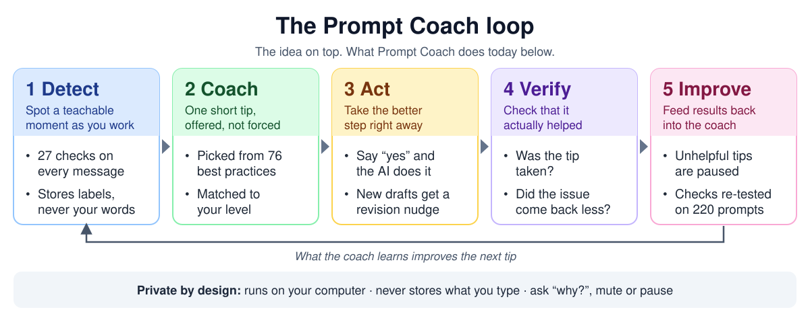

# Prompt Coach

[](https://github.com/amrogers2007/prompt-coach/actions/workflows/test.yml)

**A coach that lives inside Claude and teaches people to use AI well, while they work.**

Companies have handed their people AI. Few have taught them to use it: 88% of employees use AI at work, mostly for
search and summaries, and only 12% say they get enough training ([sources](docs/COACHING-LOOP.md)). A course doesn't
fix that, because using AI well is a set of small habits: say who the document is for, treat the first draft as a
draft, check the number before you send it.

Prompt Coach teaches those habits at the moment they matter. It's a plugin for Claude (the desktop app and Claude
Code). It doesn't rewrite your prompts. It spots a teachable moment, offers one short tip after the answer, and if
you say yes, the AI does the better step with you. What it learns about your habits stays on your computer, where
it becomes an **AI Fluency level** and a private dashboard that shows how your habits change.

```
You:    write an email about the office move
Claude: (writes the email)
        ...
        *💡 **Prompt Coach:** Knowing who will read this would sharpen the tone. Who is it for?*
```

## See it without installing

- **[Sample dashboard](https://amrogers2007.github.io/prompt-coach/)**: the private page every user gets, built
  here from made-up history.
- **[The coaching loop](docs/COACHING-LOOP.md)**: the problem, how the coach works, and the evidence so far. Two
  minutes to read.

## Install

**Windows:** [download `PromptCoachSetup.exe`](https://github.com/amrogers2007/prompt-coach/releases/latest/download/PromptCoachSetup.exe),
double-click it, and click Install. It needs nothing else on the computer and sets up the Claude desktop app's
Chat, Cowork and Code tab in one go ([details](coach/README.md#install)). Windows shows a "protected your PC"
notice because the program isn't signed yet: click *More info*, then *Run anyway*.

**macOS, Linux, or from the command line:**

```bash
claude plugin marketplace add amrogers2007/prompt-coach
claude plugin install prompt-coach@prompt-coach
```

That covers Claude Code and the desktop app's Code tab. To coach in the desktop app's regular chat as well, follow
the short setup in [`coach/README.md`](coach/README.md#install). This route requires Python 3.9 or newer; the
Windows setup program does not.

## How it works



| Step | What Prompt Coach does |
|---|---|
| **1. Detect** | 27 checks spot moments like a missing audience or an unchecked number. Only labels are stored. |
| **2. Coach** | Offers one short tip, after the answer, from a [library of 76 best practices](coach/library/recommendations.md). |
| **3. Act** | If you say "yes", the AI does the better step with you, such as asking who your reader is. |
| **4. Verify** | Tracks whether tips are taken and whether the issue comes back less often. |
| **5. Improve** | Pauses tips people keep turning down. Re-tests the checks on every change. |

You also get:

- **An AI Fluency level** (Beginner, Practitioner, Advanced, Expert) based on what you do, not a quiz.
- **A private dashboard** of your habits over time, with goals, a weekly recap, and badges.
- **Control:** ask why a tip appeared, mute it, pause the coach, or turn it off.
- **Privacy:** the coach runs on your computer and never stores what you type.

## What's proven, and what isn't yet

- **It spots the right moments.** Measured against 220 labeled prompts. On prompts it had never seen, 93% of the
  moments it flagged were real and it caught 88% of them; a second blind set scored 80% on both. Details, including
  the weaker numbers, are in [COACHING-LOOP.md](docs/COACHING-LOOP.md).
- **The measurement for "did habits change?" is built.** A pilot mode holds back coaching on a random share of
  issues per person, so coached and uncoached issues can be compared. In simulated pilots, coached issues came back
  7% of the time against 18% for uncoached ones.
- **Not yet shown: that it changes real behavior at work.** That needs a pilot with real people. The next step is a
  three-to-four-week pilot with a small group in pilot mode, then pooled results.
- **Tested by hand on Windows** (Claude Code and the desktop app's chat). The same code runs on macOS and Linux and
  is tested in CI on both Python 3.9 and 3.13, but it hasn't been tried by hand on a Mac yet.

## What's in this repo

| Folder | What it is |
|---|---|
| [`coach/`](coach/) | The plugin: hooks, skills, the coach agent, the recommendation library, and 340+ automated tests (Python, standard library only). |
| [`docs/`](docs/) | Why it works the way it does: the coaching loop, design notes, and the research behind the library. |
| [`install/`](install/) | Guided installers for macOS, Linux and Windows. |

## Documents

- [COACHING-LOOP.md](docs/COACHING-LOOP.md): the problem, the loop, and how it's tested. Start here.
- [COACH-DESIGN.md](docs/COACH-DESIGN.md): design decisions and what's still open.
- [BEST-PRACTICES-SOURCE.md](docs/BEST-PRACTICES-SOURCE.md): the research table many recommendations came from.
- [CHANGELOG.md](CHANGELOG.md): what changed in each version.
- [history/](docs/history/): early planning notes and interviews, kept for the record.

## About

Built by Amanda Rogers (CS + Physics, Harvey Mudd), from user interviews to a working, tested product.
Released under the MIT license.
